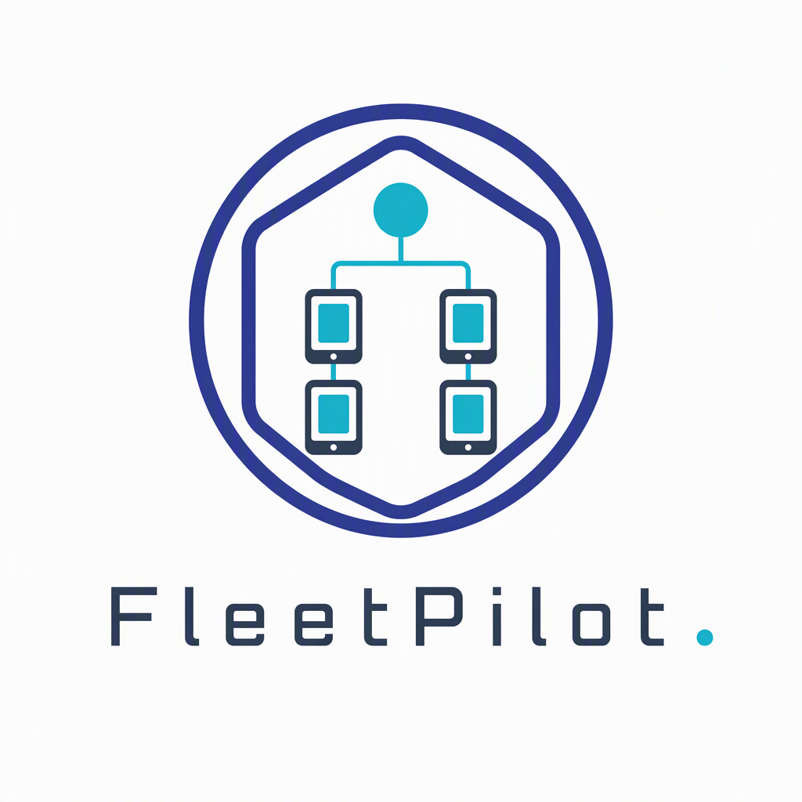
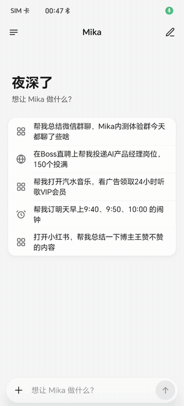
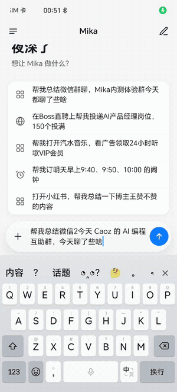
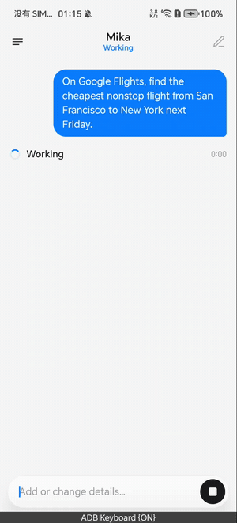

<div align="center">

# FleetPilot



**One screen, a whole fleet of phones.**

Assign tasks to multiple Android devices in natural language and watch their progress,
notifications, and live screens from one place. Both iPhone and Android can be the controller.

[](LICENSE)
[](#development-and-builds)
[](REMOTE-IOS.md)
[](#repository-layout)
[](UPSTREAM.md)

[简体中文](README.md) · English

[What it is](#what-it-is) · [Getting started](#getting-started) · [Development](#development-and-builds) · [Docs](#documentation) · [Provenance](#provenance-and-license)

</div>

> **Provenance first.** FleetPilot is a derivative of
> **[mylea1/phongent](https://github.com/mylea1/phongent)** (Apache-2.0): the code was pulled,
> renamed, and the documentation rewritten. **No existing line of code was changed.**
> phongent is itself derived from [wangzan101/mika](https://github.com/wangzan101/mika), and that
> chain is still recorded in [NOTICE](NOTICE). See [UPSTREAM.md](UPSTREAM.md) for the exact diff
> and how to verify it. What this fork intends to add is described in
> [Development plan](#development-plan) — none of it is written yet.

## What it is

FleetPilot lets one phone (or an iPhone) drive many Android devices at once: send a task to all
devices, to a group, or to one named device, and review each device's progress, notifications and
live screen from the controller — including replying to a notification on the device that received it.

Android can manage other devices and operate locally; iOS acts as a controller against Android runners.

| Capability | iOS | Android |
| --- | --- | --- |
| Connect to and manage other Android devices | Supported | Supported |
| Assign tasks, review results and messages | Supported | Supported |
| View the Android live window and take over | Supported | Supported |
| Execute local app operations | — | Supported |

## Demos

[▶ Reply to a notification on a controlled device](docs/media/demos/notification-reply.mp4)

[▶ Drive a phone through a task](docs/media/demos/phone-task-control.mp4)

<table>
  <tr>
    <td width="50%"></td>
    <td width="50%"></td>
  </tr>
  <tr>
    <td></td>
    <td></td>
  </tr>
</table>

## Highlights

- **Per-device task assignment** — long-press a device and describe its task, or let the controller's
  agent split and route the work.
- **Groups** — batch grouping, collapsible avatars, assign to a whole group, or override one device inside it.
- **Content generation and fan-out** — the controller model writes several copies and text cards, then
  hands each one to the matching device, with images attached.
- **Live window** — watch the Android virtual display and take over with taps, swipes and typing.
- **Notification inbox** — organised by device, app and source, with replies sent through that device's agent.
- **Central configuration** — memory, skills, scheduled tasks and action routes, per device or in bulk.
- **Connection management** — LAN discovery, authorisation, one-tap connect, reconnect, renaming.

## How tasks are phrased

```text
A: open the profile page and take a screenshot. B: open the browser and check today's weather.
```

```text
Content group: each device drafts one product intro. Review group: check every device's task status.
Device A in the content group switches to organising existing material; the rest keep drafting.
```

## Getting started

1. **Build and install the runner.** This repository publishes no binaries yet, so build it yourself
   (see [Development](#development-and-builds)). Upstream ships its own releases — those are upstream
   artifacts, not builds of this fork. Install with your own development signature.
2. **Configure the Android runner.** Set the model, then grant the permissions each feature needs
   (accessibility, notification access). System-side setup is in [docs/setup-guide.md](docs/setup-guide.md);
   some names there still follow the upstream client.
3. **Connect devices.** Controller and runners must share a LAN and keep the Android service running.
   Pick devices or hit one-tap connect; approve on the device the first time.
4. **Configure the controller model** in settings; account sign-in happens on the device itself.
5. **Start collaborating.** Choose all devices, a group, or one device, type a task, read results per device.

### Groups

- The grid shows connected devices only, labelled with name and group.
- Each device belongs to one group; moving it leaves the previous group. Ungrouped devices sit in "Default".
- Groups are stored on the controller in use and **do not sync between controllers**.

### Four entry points

| Entry | Purpose |
| --- | --- |
| Devices | Discovery, connection, renaming, grouping |
| Agent | Task assignment, results, live window |
| Messages | Notifications by device, app and source |
| Settings | Controller, runner and sync options |

## Development and builds

| Directory | Contents |
| --- | --- |
| `app/` | Android app, controller UI and runner service |
| `core/` | Agent core |
| `ios/` | iOS controller, components, Live Activities |
| `tools/android-emulators/` | Emulator harness |
| `docs/` | Setup guides, protocol notes, verification records |

**Android**: JDK 17 and the Android SDK (compileSdk 36); minimum installable version Android 12.
This fork raised minSdk from 30 to 31 because the frosted-glass chrome needs API 31 backdrop blur —
Android 11 can no longer install. Device-operation capabilities depend on further system versions and permissions.

```sh
./gradlew :app:assembleDebug
```

**iOS**: macOS with an Xcode that supports the SDKs used here, minimum deployment target iOS 17.
Open `ios/MikaRemote.xcodeproj`, select the MikaRemote scheme, choose your own signing team.
See [REMOTE-IOS.md](REMOTE-IOS.md).

Never commit model keys, account credentials or signing material.

## Generated lists

Both blocks below are produced by the build, not written by hand; run `./gradlew updateReadme` to fill them.

**Built-in knowledge** (apps, websites, how-to skills):

<!-- generated:knowledge:start -->

<!-- generated:knowledge:end -->

**Provider presets**:

<!-- generated:providers:start -->

<!-- generated:providers:end -->

## Security and limits

Read this before pointing it at devices you care about:

- **The LAN transport has no encryption layer.** The computer-facing endpoint states plainly that it
  does no TLS and relies on accepting private addresses only, plus a bearer token — see the MCP
  section of [docs/architecture.md](docs/architecture.md). Think twice before running this on public Wi-Fi.
- **The runner asks for system-level permissions.** Accessibility, notification access and
  write-settings go far beyond "tap the screen for me". Grant them only on devices you control.
- **Controllers do not sync.** Groups and settings live on the controller in use; two controllers see two states.
- **The client identity is still upstream's.** Package name, iOS target and in-app naming are unchanged —
  list in [UPSTREAM.md](UPSTREAM.md).
- **Nothing here has been verified on real hardware yet.** The UI code has been changed once (single-hue
  palette and glass materials — see `docs/ui-redesign.md`), but it has **never been compiled or run on a
  device**: this machine has neither the Android SDK nor Xcode, so verification stops at Swift syntax
  parsing and a structural check of the Kotlin edits. No "tested on" claim is made anywhere.

## Development plan

What follows is the plan, not the current state. Upstream stops at routing: the controller dispatches
tasks and collects outcomes, devices never talk to each other and nobody judges whether the work actually
got done. The layers to add:

| # | Layer | What is missing today |
| --- | --- | --- |
| 1 | Always-on coordinator | The controller is a phone; lock the screen or kill the app and nobody owns the batch |
| 2 | Objective entity | Work is a single instruction to one device, with no cross-device, cross-time object to hang state on |
| 3 | Outcome acceptance | Runners report "done"; nothing checks it. An automated fleet that never learns whether it succeeded is worse than manual |
| 4 | Idempotent dispatch ledger | Without it, a retry is a duplicate order |

Layer 3 is the reason this fork exists. Judging outcomes needs messy real traces, and "N phones ×
M tasks × plaintext transport × no exactly-once delivery" is a generator for exactly that. Progress
will be recorded under `docs/` and summarised here.

## Documentation

| Document | Topic |
| --- | --- |
| [docs/setup-guide.md](docs/setup-guide.md) | System-side setup for device operation |
| [docs/architecture.md](docs/architecture.md) | Structure, protocols, where each capability lives |
| [docs/install-with-agent.md](docs/install-with-agent.md) | Letting an agent do the install and grants |
| [docs/mcp.md](docs/mcp.md) | Exposing the phone as an MCP server / client |
| [docs/knowledge-format.md](docs/knowledge-format.md) | Built-in knowledge format |
| [docs/controller-parity.md](docs/controller-parity.md) | iOS vs Android controller parity |
| [docs/roadmap.md](docs/roadmap.md) | Upstream's own roadmap and known issues |
| [REMOTE-IOS.md](REMOTE-IOS.md) | iOS controller against Android runners |
| [UPSTREAM.md](UPSTREAM.md) | Provenance, diff list, how to verify |

## Provenance and license

Code is distributed under the **Apache License 2.0** — see [LICENSE](LICENSE). Third-party attribution
lives in [NOTICE](NOTICE) and [THIRD_PARTY_NOTICES.md](THIRD_PARTY_NOTICES.md), including upstream's
notice for Mika, kept verbatim.

Chain: [wangzan101/mika](https://github.com/wangzan101/mika) →
[mylea1/phongent](https://github.com/mylea1/phongent) → this repository.
Upstream commit `0b57e35d4e4c8460fdd87fcd33f751f764e7423d`, pulled 2026-11-02.

Upstream author: [mylea · @myleafy1](https://x.com/myleafy1).
**Please open an issue here rather than asking upstream for support on this fork.**

Maintainer: [NIU-123370](https://github.com/NIU-123370).
