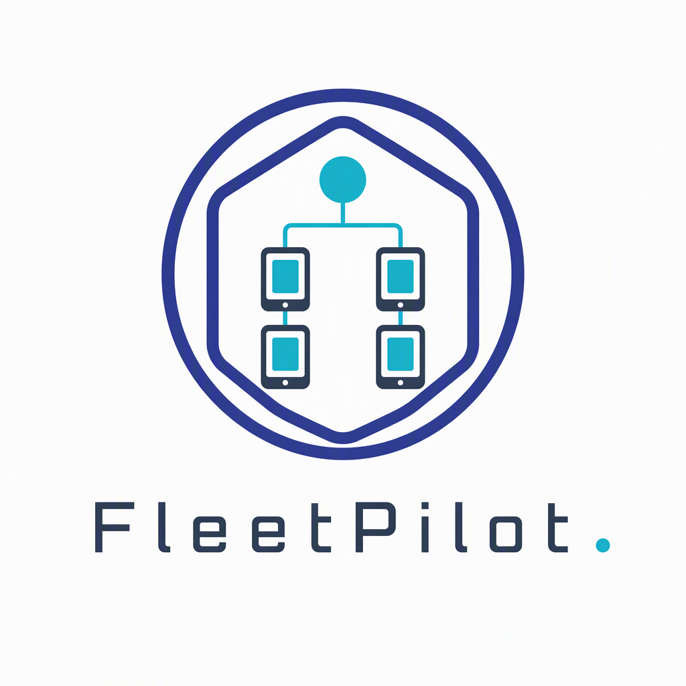
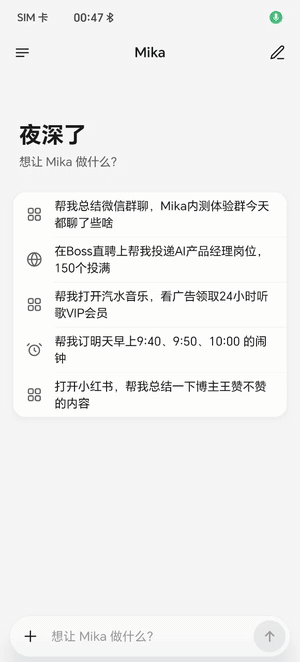
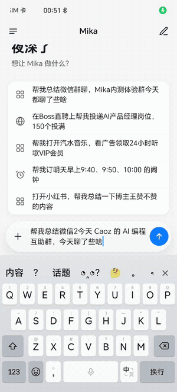
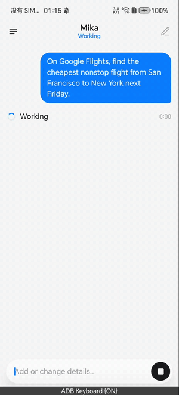

<div align="center">

# FleetPilot



**一个界面，指挥一排手机。**

用自然语言给多台安卓设备派活，进度、消息、实时画面集中看；iPhone 和安卓都能当指挥的那台。

[](LICENSE)
[](#开发与构建)
[](REMOTE-IOS.md)
[](#目录结构)
[](UPSTREAM.md)

简体中文 · [English](README.en.md)

[是什么](#是什么) · [快速开始](#快速开始) · [开发与构建](#开发与构建) · [文档](#文档索引) · [出处与许可](#出处与许可)

</div>

> **出处先说清楚。** FleetPilot 是 **[mylea1/phongent](https://github.com/mylea1/phongent)**
> （Apache-2.0）的衍生项目：拉取代码后改名、重写文档，**既有代码一行没动**。
> 上游自己又是 [wangzan101/mika](https://github.com/wangzan101/mika) 的衍生项目，
> 这条授权链在 [NOTICE](NOTICE) 里原样带着。逐条差异和核对方法见 [UPSTREAM.md](UPSTREAM.md)。
> 本仓库要做的增量在[二次开发计划](#二次开发计划)一节，那部分还没开始写。

## 是什么

FleetPilot 让一台手机（或 iPhone）同时指挥多台安卓设备：向全部设备、某个分组、或指定某台下发任务，
在一个页面里看各自的执行进度、收到的通知和实时屏幕，并从主控端直接回复被控设备的消息。

安卓既能管理别的设备，也能直接操作本机；iOS 作为主控连接安卓执行端。

| 设备角色 | iOS | Android |
| --- | --- | --- |
| 作为主控，连接和管理其他安卓设备 | 支持 | 支持 |
| 分配任务、查看结果与消息 | 支持 | 支持 |
| 查看安卓实时小窗、接管操作 | 支持 | 支持 |
| 执行本机 App 操作任务 | — | 支持 |

## 演示

### 回复被控设备的消息

从通知进入回复窗口，把回复这件事交给对应设备的 agent。

[▶ 演示：回复消息通知](docs/media/demos/notification-reply.mp4)

### 控制设备执行任务

下发任务，看 agent 在手机上一步步操作。

[▶ 演示：控制手机执行任务](docs/media/demos/phone-task-control.mp4)

### 设备在干什么

<table>
  <tr>
    <td width="50%"></td>
    <td width="50%"></td>
  </tr>
  <tr>
    <td></td>
    <td></td>
  </tr>
</table>

## 核心功能

- **多设备任务分配**：长按某台设备直接描述它的任务，也可以让主控的任务代理自行拆分下发。
- **按组协作**：批量分组、折叠组内头像、选中整组下发；不同组可以是不同任务，组内也能单独指定。
- **内容创作与分发**：主控模型生成多份文案和文字图卡，把内容与任务分别交给对应设备，可附带图片。
- **实时小窗**：查看安卓虚拟屏画面，用点击、滑动、输入接管操作；小窗默认开启，可在设置里关掉。
- **消息集中查看**：按设备、应用、来源组织通知，查看详情并通过目标设备的 agent 回复。
- **集中配置**：记忆、技能、定时任务、操作路线等，按功能选择单台或批量操作。
- **连接与管理**：局域网发现、授权连接、一键连接、断线重连、设备重命名、已连接设备网格。

## 怎么下发任务

```text
A 打开小红书主页并截图，B 打开浏览器查看今天的天气。
```

```text
内容组分别生成一份产品介绍草稿，检查组查看各设备的任务状态。
内容组里的 A 改为整理已有素材，其余设备继续生成草稿。
```

```text
为内容组的每台设备生成不同的标题、正文和文字图卡，
分别下发给对应设备，保存为草稿，暂不发布。
```

## 快速开始

1. **构建并安装执行端。** 本仓库暂不发布安装包，需要自己构建（见[开发与构建](#开发与构建)）；
   上游仓库有自己的 release，但那是上游的产物，不要当作本仓库的构建使用。
   安装时确认用的是你自己的开发签名。
2. **配置安卓执行端。** 在应用内填模型配置、开手机操作权限（无障碍、通知读取等按需授予）。
   底层设置见[设置指南](docs/setup-guide.md)，其中部分名称仍沿用上游客体。
3. **连接设备。** 主控与执行端接入同一局域网，保持安卓端服务运行；主控在「设备」页选设备或点
   「一键连接」，首次连接在安卓端允许。已授权设备支持重连。
4. **配置主控模型。** 在主控设置里配任务下发模型；账号登录在对应设备上完成。
5. **开始协作。** 在 agent 页选择全部、设备组或单台设备，输入任务，按设备看进度和结果。

### 设备与分组

- 下方网格只显示已连接设备，卡片标注名称与所属组。
- 点「分组」，勾选设备，选已有组或新建组，再点「移动 N 台」。
- 每台设备属于一个组，移动后离开原组；未分组的设备归入「默认组」。
- 长按设备头像或卡片可重命名或移动分组。重命名会同步到对应安卓 App 内的设备名称，需要执行端支持该接口。
- agent 页左侧按组显示头像、支持折叠。分组保存在当前主控端，**不会自动同步到其他主控**。

### 四个入口

| 入口 | 用途 |
| --- | --- |
| 设备 | 发现、连接、重命名、分组 |
| agent | 分配任务、查看执行结果和实时小窗 |
| 消息 | 按设备、应用、来源查看通知 |
| 设置 | 配置主控、执行端及同步选项 |

## 开发与构建

| 目录 | 内容 |
| --- | --- |
| `app/` | Android 应用、主控界面和执行端服务 |
| `core/` | agent 核心能力 |
| `ios/` | iOS 主控、组件与实时活动 |
| `tools/android-emulators/` | 安卓模拟器联调工具 |
| `docs/` | 设置指南、协议和验证记录 |

**Android**：JDK 17、Android SDK（当前 compileSdk 36）；最低安装版本 Android 11，
具体手机操作能力另受系统版本与权限限制。

```sh
./gradlew :app:assembleDebug
```

产物在 app/build/outputs/apk/debug/ 下（构建目录，不在版本库里）。

**iOS**：macOS、支持本项目所用 SDK 的 Xcode，最低部署版本 iOS 17。打开
`ios/MikaRemote.xcodeproj`，选 MikaRemote scheme，在签名设置里选自己的开发团队后构建。
iOS 侧的连接方式与限制见 [REMOTE-IOS.md](REMOTE-IOS.md)。

模型密钥、账号凭证和本机签名材料不要写进源码。

## 内置清单

下面两段由构建任务生成，不手写：跑一次 `./gradlew updateReadme` 就会填上，
`core` 的 README 一致性测试守着它们和源头不脱节。

**内置知识**（App、网站、通用做法）：

<!-- generated:knowledge:start -->

<!-- generated:knowledge:end -->

**服务商预设**：

<!-- generated:providers:start -->

<!-- generated:providers:end -->

## 安全与边界

用之前要知道的几件事，都来自代码与文档本身，不是猜测：

- **局域网传输没有加密层。** 电脑连接那条路径自己写明「不做 TLS，靠只收私有地址和访问令牌把关」，
  见 [docs/architecture.md](docs/architecture.md) 的 MCP 一节。换到公共 Wi-Fi 上跑之前先想清楚这一点。
- **执行端要的是系统级权限。** 无障碍、通知读取、修改系统设置这类授权一旦给出，能做的事远超
  「帮你点一下屏幕」，只在你能控制的设备上开。
- **主控之间不同步。** 分组、配置都存在当前这台主控上，两台主控看到的是两套状态。
- **客体标识仍是上游的。** 包名、iOS target、界面文案里的 `Mika` 字样都没改，
  清单见 [UPSTREAM.md](UPSTREAM.md#还没改名的部分二次开发要一起处理的)。
- **本仓库没跑过真机验证。** 目前只做了拉取、改名、重写文档；构建与设备联调待补，
  所以这里不写任何"在某型号手机上实测通过"的说法。

## 二次开发计划

这一节是**要做的事**，不是已完成的功能。上游把"设备间协同"停在路由层面：主控只负责把任务发下去、
把结局收回来，设备之间不传东西、也没有谁对结果负责。要补的是下面这几层：

| # | 要加的东西 | 为什么现在缺 |
| --- | --- | --- |
| 1 | 常驻协调器 | 现在"主控"是一部手机，屏幕一锁、App 一被杀，整批任务就没人管了。协调器得住在一个不睡觉的地方 |
| 2 | Objective 实体 | 任务当前以"发给某台设备的一条指令"为单位，没有跨设备、跨时间的目标对象可以挂状态 |
| 3 | 结果验收 | 执行端只回"做完了"，没人判断是不是真做完了。没有这一层，自动集群只是不知疲倦且永远不知道自己有没有办成 |
| 4 | 指令侧幂等账本 | 没有它，重试就是重复下单 |

第 3 条是这个衍生项目的主要动机。验收层做出来需要大量真实脏数据，而"多台手机 × 多条任务 ×
明文传输 × 不保证只投递一次"正好是脏数据发生器——这也是我拿这个仓当试验场而不是从零造样本的原因。
做到哪一步、测出什么，会写进 `docs/` 并同步在这里。

## 文档索引

| 文档 | 讲什么 |
| --- | --- |
| [docs/setup-guide.md](docs/setup-guide.md) | 手机操作能力的系统侧设置 |
| [docs/architecture.md](docs/architecture.md) | 主控与执行端的结构、协议、各能力实现位置 |
| [docs/install-with-agent.md](docs/install-with-agent.md) | 让 agent 自己完成安装与授权 |
| [docs/mcp.md](docs/mcp.md) | 把手机接成 MCP 服务器 / 客户端 |
| [docs/knowledge-format.md](docs/knowledge-format.md) | 内置知识的格式 |
| [docs/controller-parity.md](docs/controller-parity.md) | iOS 与安卓主控的能力对照 |
| [docs/roadmap.md](docs/roadmap.md) | 上游自己的计划与已知问题 |
| [REMOTE-IOS.md](REMOTE-IOS.md) | iOS 主控连安卓执行端 |
| [UPSTREAM.md](UPSTREAM.md) | 出处、差异清单、核对方法 |

## 出处与许可

代码以 **Apache License 2.0** 分发，见 [LICENSE](LICENSE)。第三方资源的署名与许可见
[NOTICE](NOTICE) 和 [THIRD_PARTY_NOTICES.md](THIRD_PARTY_NOTICES.md)，其中包含上游对
Mika 的声明，本仓库原样保留。

授权链：[wangzan101/mika](https://github.com/wangzan101/mika) →
[mylea1/phongent](https://github.com/mylea1/phongent) → 本仓库。
上游提交 `0b57e35d4e4c8460fdd87fcd33f751f764e7423d`（2026-11-02 拉取）。

上游作者：[mylea · @myleafy1](https://x.com/myleafy1)。
**本仓库的问题请开 issue，不要联系上游作者要支持。**

本仓库维护者：[NIU-123370](https://github.com/NIU-123370)。
